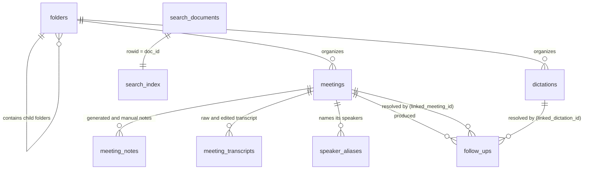

# Muesli Windows SQLite database guide

This document is the contributor and coding-agent map of the Muesli Windows library database.
Read it before changing anything under
[`windows-native/Muesli.Windows.Core/Services/Persistence/`](windows-native/Muesli.Windows.Core/Services/Persistence/),
and update it in the same change whenever the schema or the deletion behaviour changes.

The executable source of truth is
[`PersistenceSchema.cs`](windows-native/Muesli.Windows.Core/Services/Persistence/PersistenceSchema.cs).
If this guide and that file disagree, the file is right and this guide has a bug.

The macOS app has its own database with a different schema, documented in `database-schema.md`
in the `Muesli-HQ/muesli` repository. The two databases are not interchangeable and nothing
syncs between them.

## Where the database lives

The database is `muesli.db` in the `data` folder of the active profile.

| Build | Database |
| --- | --- |
| Normal build (`Muesli.Windows`) | `%APPDATA%\muesli\data\muesli.db` |
| Development slot (`MuesliDevA`, `MuesliDevB`, ...) | `%APPDATA%\MuesliDev<Slot>\data\muesli.db` |
| Isolated preview or test (`MUESLI_PROFILE_ROOT` or `--profile-root`) | `<root>\data\muesli.db` |

`MuesliProfilePaths.Current()` resolves the profile; `PersistencePaths.DatabasePathFor` adds the
file name. While the app runs you will also see `muesli.db-wal` and `muesli.db-shm` beside it.
Those two files are part of the database. Never copy, move or delete `muesli.db` on its own
while they exist.

## Storage rules at a glance

- SQLite is the only store for library history. There is no JSON history mode, no fallback and
  no flag that selects one.
- One connection per process, opened by `MuesliDatabase`. Foreign keys are on, the journal mode
  is WAL, `synchronous` is `NORMAL` and the busy timeout is five seconds.
- A profile lease (`WindowsProfileLeaseFactory`) allows one Muesli process per profile, so the
  database has a single writer.
- Every table is `STRICT`. A value of the wrong type is an error, not a silent conversion.
- Timestamps are UTC **ticks** (100 ns units since 0001-01-01) in `INTEGER` columns, converted
  only by `PersistenceTime`. Do not store seconds, milliseconds or text dates.
- Enums are stored as explicit strings (`'raw'`, `'edited'`, `'open'`, ...) by
  `PersistenceEnums`, never as ordinals. The `CHECK` constraints are written against those
  strings.
- Booleans are `INTEGER` 0 or 1.
- Ids are application-generated text. Nothing relies on `rowid` except the search index.
- Multi-statement writes go through `MuesliDatabase.BeginTransaction()`. Nested scopes join the
  outer transaction; disposing a scope without committing rolls the whole unit back.
- Deletion is a real `DELETE`. There are no tombstones and no soft-delete columns, because
  nothing syncs.
- The full-text index is maintained by application code inside the writing transaction
  (`SearchIndexWriter`), not by triggers.

## Relationship map



`templates`, `dictionary_entries` and `schema_migrations` stand alone.
`search_documents` points at a dictation, meeting or folder through a logical
`(record_kind, record_id)` pair, not a foreign key.

## Table catalog

### `dictations`

One row per saved dictation.

| Column | Type | Meaning |
| --- | --- | --- |
| `id` | TEXT PK | Application id. |
| `created_at_utc` | INTEGER | When the dictation was made. This is the time the user sees. |
| `updated_at_utc` | INTEGER | Last change to the row, including a text correction. |
| `title` | TEXT | Optional title. Empty for ordinary dictations. |
| `text` | TEXT | The transcript as pasted. A correction rewrites this column. |
| `duration_ms` | INTEGER | Length of the recording. |
| `model_profile` | TEXT | Id of the transcription model that produced the text. |
| `folder_id` | TEXT NULL | Folder, or NULL when unfiled. `ON DELETE SET NULL`. |
| `word_count` | INTEGER | Derived from `text` by `LibraryMetrics.CountWords`. Recompute it whenever `text` changes. |
| `audio_path` | TEXT NULL | Capture this dictation came from, kept for provenance. |
| `audio_retained` | INTEGER | 1 while Muesli still owns the file at `audio_path`. |

Indexes: `ix_dictations_created (created_at_utc DESC)`,
`ix_dictations_folder (folder_id, created_at_utc DESC)`.

Text is only ever changed by a compare-and-swap: `SqliteLibraryHistoryAdapter.TryUpdateDictationText`
and `SaveCorrection` both require the caller's copy of the old text to match the stored one.

### `meetings`

One row per meeting, without its large text. Transcripts, notes, aliases and follow-ups are
child rows so a history list never loads megabytes of transcript.

| Column | Type | Meaning |
| --- | --- | --- |
| `id` | TEXT PK | Application id. |
| `title` | TEXT | Displayed title. |
| `title_is_manual` | INTEGER | 1 once the user edited the title; a regenerated title must not replace it. |
| `created_at_utc`, `updated_at_utc` | INTEGER | Start of the meeting, and last change. |
| `duration_ms` | INTEGER | Recorded length. |
| `model_profile` | TEXT | Transcription model id. |
| `folder_id` | TEXT NULL | Folder, `ON DELETE SET NULL`. |
| `word_count` | INTEGER | Derived from the displayed transcript. |
| `template_name` | TEXT | Name of the notes template used. A name, not a foreign key to `templates`. |
| `session_state` | TEXT | `MeetingSessionState` name, for example `Completed`. An unknown value reads as `Completed` so a meeting from a newer build is still listed. |
| `recovered_from_interruption` | INTEGER | 1 when the meeting was rebuilt from a recording journal after a crash or shutdown. |
| `health_warnings_json` | TEXT | JSON array of capture-health warnings. |
| `source_path` | TEXT | Original file for an imported recording. Imported files are user-owned and never deleted by Muesli. |
| `microphone_audio_path`, `system_audio_path` | TEXT NULL | Muesli-owned capture files, when the recording was saved. |
| `system_capture_mode` | TEXT | How system audio was captured. |
| `live_preview_model_id` | TEXT NULL | Model used for the live transcript, if any. |
| `live_transcript_ownership` | TEXT | Which pipeline owned the live transcript; `off` when there was none. |
| `final_transcript_owner_model_id` | TEXT | Model that owns the final transcript. |
| `gap_recovery_model_id` | TEXT NULL | Model used to fill capture gaps, if any. |
| `automation_result_json` | TEXT NULL | Outcome of the most recent post-meeting hook or export run, stored verbatim so unknown fields round-trip. A save that carries a result replaces it; a save without one keeps it. |
| `source_schema_version` | INTEGER | Meeting record schema the row was written with (`PersistedMeeting.CurrentSchemaVersion` for new rows). |

Indexes: `ix_meetings_created`, `ix_meetings_folder`, `ix_meetings_state`.

### `meeting_notes`

| Column | Type | Meaning |
| --- | --- | --- |
| `meeting_id` | TEXT | Owning meeting, `ON DELETE CASCADE`. |
| `kind` | TEXT | `generated` (rewritten by every re-summarization) or `manual` (the user's own notes; never overwritten by a regeneration). |
| `content` | TEXT | The note. |
| `created_at_utc`, `updated_at_utc` | INTEGER | |

Primary key `(meeting_id, kind)`: at most one of each per meeting. Saving an empty note deletes
the row, which is how a user clears notes.

### `meeting_transcripts`

| Column | Type | Meaning |
| --- | --- | --- |
| `meeting_id` | TEXT | Owning meeting, `ON DELETE CASCADE`. |
| `kind` | TEXT | `raw` (exactly what the model produced) or `edited` (the user's corrected version). |
| `content` | TEXT | Transcript text. |
| `created_at_utc`, `updated_at_utc` | INTEGER | |

Primary key `(meeting_id, kind)`. The app shows `edited` when it exists and `raw` otherwise.
A UI save never destroys the `raw` row; clearing the edit reveals it again.

The first non-empty transcript saved for a meeting is always `raw`, even when the meeting row
already existed (notes typed while recording, or a follow-up draft, save the row before any
speech is recognized). Every later, different transcript is `edited`. macOS keeps one transcript
column that finalization fills and edits overwrite; Windows shows the same single transcript and
additionally keeps the recognizer's original.

### `speaker_aliases`

`(meeting_id, speaker_key)` primary key. `speaker_key` is the diarized label as emitted
(`Speaker 1`); `alias` is the name the user gave. Cascades with the meeting.

### `follow_ups`

| Column | Type | Meaning |
| --- | --- | --- |
| `id` | TEXT PK | A meeting-continuation link uses the id `meeting_thread_<successor id>`. |
| `meeting_id` | TEXT | Meeting that produced it, `ON DELETE CASCADE`. |
| `text`, `owner` | TEXT | The item and who owns it. |
| `due_at_utc` | INTEGER NULL | |
| `status` | TEXT | `open`, `done` or `dismissed`. |
| `linked_meeting_id` | TEXT NULL | Meeting that resolved or continues it, `ON DELETE SET NULL`. |
| `linked_dictation_id` | TEXT NULL | Dictation that resolved it, `ON DELETE SET NULL`. |
| `created_at_utc`, `updated_at_utc` | INTEGER | |

Indexes on `(meeting_id, status, created_at_utc)`, `linked_meeting_id` and `linked_dictation_id`.

### `folders`

| Column | Type | Meaning |
| --- | --- | --- |
| `id` | TEXT PK | |
| `name` | TEXT | |
| `parent_id` | TEXT NULL | Parent folder, NULL for a root. `ON DELETE SET NULL`. |
| `sort_order` | INTEGER | Position among siblings. |
| `metadata` | TEXT | Free-form user text; searchable. |
| `created_at_utc`, `updated_at_utc` | INTEGER | |

Deleting a folder never deletes the history inside it. `FolderDeleteMode.Detach` moves child
folders up one level and unfiles the items; `CascadeFolders` removes the subtree and unfiles the
items. The repository rejects a move that would create a cycle.

### `templates`

Meeting-notes templates: `id`, `name`, `prompt`, `icon`, `sort_order`, timestamps.
Index `ix_templates_order (sort_order, name)`.

### `dictionary_entries`

Custom dictionary words and remembered corrections. They are the same kind of row: a rule
applied to every future transcription by `DictionaryCorrectionService.Apply`.

| Column | Type | Meaning |
| --- | --- | --- |
| `id` | TEXT PK | |
| `phrase` | TEXT | What the recognizer produces. |
| `phrase_key` | TEXT | `DictionaryCorrectionService.PhraseKey(phrase)`: the matcher's tokens, upper-cased, joined by one space. Two spellings the matcher treats alike share a key. Always write it through `SqliteDictionaryRepository`. |
| `replacement` | TEXT | What to write instead. Empty means the entry is vocabulary only. |
| `matching_threshold` | REAL | Jaro-Winkler threshold. The matcher clamps it to 0.85 to 0.98. |
| `sort_order` | INTEGER | Order shown on the Dictionary page. |

Index `ix_dictionary_phrase (phrase_key)`.

A correction made on the Dictations page with "Remember" ticked writes the dictation text, its
word count, its search document and the dictionary rule in one transaction
(`SqliteLibraryHistoryAdapter.SaveCorrection`). "Remember" is off by default: a correction
changes one dictation unless the user asks for a rule.

### `search_documents` and `search_index`

`search_documents` gives each searchable record a stable integer id:

| Column | Type | Meaning |
| --- | --- | --- |
| `doc_id` | INTEGER PK AUTOINCREMENT | Also the `rowid` of the matching `search_index` row. |
| `record_kind` | TEXT | `dictation`, `meeting` or `folder`. |
| `record_id` | TEXT | Id in the owning table. |

`search_index` is an FTS5 virtual table (`unicode61 remove_diacritics 2`):

| Column | Indexed | Content |
| --- | --- | --- |
| `record_kind`, `record_id`, `folder_id`, `created_at` | no | Identity and the sort and filter keys. |
| `title` | yes | Meeting or dictation title, folder name. |
| `transcript` | yes | Meeting transcript (edited if present, else raw). |
| `notes` | yes | Generated and manual meeting notes. |
| `dictation_text` | yes | Dictation text. |
| `aliases` | yes | Speaker aliases. |
| `folder` | yes | Folder path the record sits in. |

A meeting's document is assembled from five tables, which is why indexing is code and not
triggers. Any new write path must call the repository (or `SearchIndexWriter`) inside its own
transaction, or the record becomes unfindable. FTS5 also creates shadow tables
(`search_index_data`, `search_index_idx`, ...). They belong to SQLite; never read or write them.

### `schema_migrations`

One row per applied schema step: `version`, `description`, `applied_at_utc`. It is a readable
history. The authoritative version is `PRAGMA user_version`.

## Versioning

- `PRAGMA user_version` is the schema version. This build writes and expects
  `PersistenceSchema.CurrentVersion`, which is **1**.
- `PRAGMA application_id` is `0x4D534C31` (`MSL1`). It marks a file as a Muesli library.
- `SchemaMigrator.Migrate` applies every step newer than the file's version, each in its own
  transaction together with its version stamp.
- A file with a **higher** version is refused (`PersistenceSchemaException`): the app says a
  newer Muesli wrote it and does not touch it.
- A file with a schema but **without** the application id is refused
  (`UnsupportedDatabaseException`). Unreleased development builds wrote versions 1 to 3 with no
  id; their numbers overlap this schema, so the id is what tells them apart.

Version 1 is the first schema to ship. It is a single step on purpose: there was no released
database to upgrade from.

## How to evolve the schema safely

1. **Never edit version 1** once a build carrying it has shipped. A database in the wild has
   already run it. Add a new `SchemaMigration` with the next number to
   `PersistenceSchema.Migrations` and raise `CurrentVersion`.
2. Make the step work on a database full of real data: add columns with a `DEFAULT` or as
   `NULL`, backfill in the same step, and rebuild a table only when SQLite cannot `ALTER` it.
3. Update every place that names columns: the repository's `SELECT` and `INSERT` lists, the
   record type in `PersistenceModels.cs` and `LibraryHistoryMapper`.
4. If the field is searchable, extend `SearchIndexWriter` and the `search_index` definition, and
   rebuild the index in the migration step.
5. Store new enums as strings through `PersistenceEnums` and new timestamps as ticks through
   `PersistenceTime`.
6. Add tests: a fresh database, an upgrade from the previous version with representative rows,
   a round-trip of the new field, and the newer-build refusal still holding.
7. Remember that an older build cannot open the upgraded file. That is by design, and it is why
   a schema change needs the same care as any other one-way step.
8. Update this guide, the Persistence `README.md` and `docs/WINDOWS_PRIVACY.md` if what is
   stored or how it is deleted changed.

Keep database work off the UI thread when it can be slow (bulk loads). Single-row
reads and writes are fast enough to stay where they are.

## What happens at launch

`LibraryDatabaseStartup.Prepare` runs once, before the app opens the library. It reads nothing
but the database header and directory listings, and it never modifies a file it did not create.

| Profile state | Outcome | What the user sees |
| --- | --- | --- |
| No database | An empty database is created. | The app, with an empty library. |
| Database present and current | Ready. | The app. |
| No database, but `muesli.db-wal` or `muesli.db-shm` present | `DatabaseMissing`. Nothing is created: the orphaned log can hold recent history and a new database would make SQLite discard it. | A dialog naming the files. |
| Database cannot be opened, or exists but is empty (no schema) | `DatabaseUnreadable`. An empty file is never given a schema. | A dialog saying how to start with an empty library. |
| Database from a newer Muesli | `DatabaseFromNewerBuild`. | A dialog saying to update Muesli. |
| Database from a pre-release build | `DatabaseFromPreReleaseBuild`. | A dialog saying which files to move aside. |

In every refusal the app exits after the dialog. It never replaces a database, or the remains of
one, with an empty library.

Pre-release development builds kept history in `windows-*.json` files in the data folder. No
released build ever did. This build does not read, convert or delete those files: a profile that
has them and no database simply starts with an empty library.

## Deletion

- Deleting a dictation removes its `dictations` row and its search document.
- Deleting a meeting removes the `meetings` row; notes, transcripts, aliases and its own
  follow-ups cascade. Follow-ups elsewhere that linked to it have the link set to NULL. Its
  search document is removed. Muesli-owned recording files are deleted by `CaptureStorageService`;
  imported source files are never touched.
- Deleting a folder unfiles its contents (see `folders`).
- SQLite does not overwrite freed pages. Deleted text can remain in unused space inside
  `muesli.db` and its WAL until SQLite reuses those pages. It is not reachable through the app
  or through search.

## What is not stored in `muesli.db`

| Data | Where | Why |
| --- | --- | --- |
| Settings | `<profile>\windows-settings.json` (atomic JSON with a `.bak`) | Small, single-writer, read before the library opens. |
| Onboarding progress | `<profile>\onboarding-progress.json` | Same. |
| In-progress recording journals | `<profile>\captures\in-progress\<meeting id>\session.json` | Rewritten constantly during a recording and read during crash recovery, before a database may be open. |
| Audio recordings | `<profile>\captures\...` | Large files. Rows hold paths, not audio. |
| Downloaded models | `%USERPROFILE%\.cache\muesli` | Shared by every build and slot. |
| API keys and sign-in tokens | Windows Credential Manager | Secrets never go in the database or in JSON. |
| Dictionary suggestions | Settings (`dictionarySuggestions`) | Pending suggestions, not rules. Accepted ones become `dictionary_entries`. |
| Logs | `<profile>\logs\` | |

## Safe inspection

Never edit a user's database by hand, and never open it for writing while Muesli is running.

To look at the schema of a live database, open it read-only and stay with metadata:

```powershell
sqlite3 -readonly "$env:APPDATA\muesli\data\muesli.db" ".tables"
sqlite3 -readonly "$env:APPDATA\muesli\data\muesli.db" ".schema dictations"
sqlite3 -readonly "$env:APPDATA\muesli\data\muesli.db" "PRAGMA user_version; PRAGMA application_id; PRAGMA quick_check; PRAGMA foreign_key_check;"
```

To work on a copy, quit Muesli first and copy `muesli.db`. Do not copy a live `muesli.db`
without its `-wal` and `-shm` files.

Muesli keeps no backup of the database, as on macOS. Anyone who wants one should copy
`muesli.db` while Muesli is closed.

Do not dump personal rows into logs, issues or chat. Transcripts and notes are the user's
private content.

Use the repositories for every change. A direct SQL write bypasses the search index, the word
counts and the compare-and-swap that protects a transcript the user is editing.

Tests must never point at a real profile. Use `TestDirectory`, `MuesliProfilePaths.Isolated`, or
`MuesliDatabase.OpenInMemory()`.
